# VoiceStick 系统架构分析

> **适用版本**：桌面端/固件 v2.4.10（根目录 `VERSION` 与 `firmware/version.txt` 同步）
> **读者对象**：参与本项目的开发与排障工程师
> **文档性质**：全系统架构的事实参考（Ref）。平台实现细节以 `Doc/Agent/desktop-architecture.md`、`Doc/Agent/firmware-architecture.md` 为准；协议字段以 `Doc/Ref/protocol.md` 为准。
> **渲染说明**：全部图表使用 Mermaid 语法，GitHub / GitLab 可直接渲染。

---

## 目录

1. [架构总览](#1-架构总览)
2. [核心模块分层](#2-核心模块分层)
3. [组件交互关系](#3-组件交互关系)
4. [关键数据流](#4-关键数据流)
5. [专用名词术语表](#5-专用名词术语表)
6. [常见故障排查指引](#6-常见故障排查指引)

---

## 1. 架构总览

### 1.1 系统定位与组成

Voice Stick 将 M5Stack StickS3（ESP32-S3）改造为**桌面端蓝牙按键语音输入设备**：设备采集按键、音频与 IMU 数据经 BLE 上报，桌面端完成交互状态机、语音识别（ASR）、文本显示与注入。系统由四个部分组成：

| 组成 | 形态 | 技术 | 职责一句话 |
|---|---|---|---|
| **固件** | M5Stack StickS3（ESP32-S3） | C / ESP-IDF v5.5.1 | 硬件 I/O、音频编码、BLE 通信、电源管理、渲染桌面端下发的 UI 状态 |
| **macOS 桌面端** | App | Swift 5.9 / AppKit / CoreBluetooth，SwiftPM | 交互状态机、ASR、文本注入、字幕、自动更新 |
| **Windows 桌面端** | App | C++20 / Win32 / C++/WinRT / Direct2D，CMake+Ninja+MSVC | 同上（双端功能对齐） |
| **网站** | 静态站点 | Vue 3 / Vite / esptool-js | 落地页、浏览器端 USB 固件烧录、更新源（appcast） |

输入设备两类并存：

- **自研 StickS3**（设备 ID `VS-XXXX`，配本仓库固件）；
- **小米蓝牙遥控器 2 Pro**（设备 ID `RC-XXXX`，**固件零改动**，Google ATVV 接入全部在桌面端完成）。

### 1.2 架构拓扑图

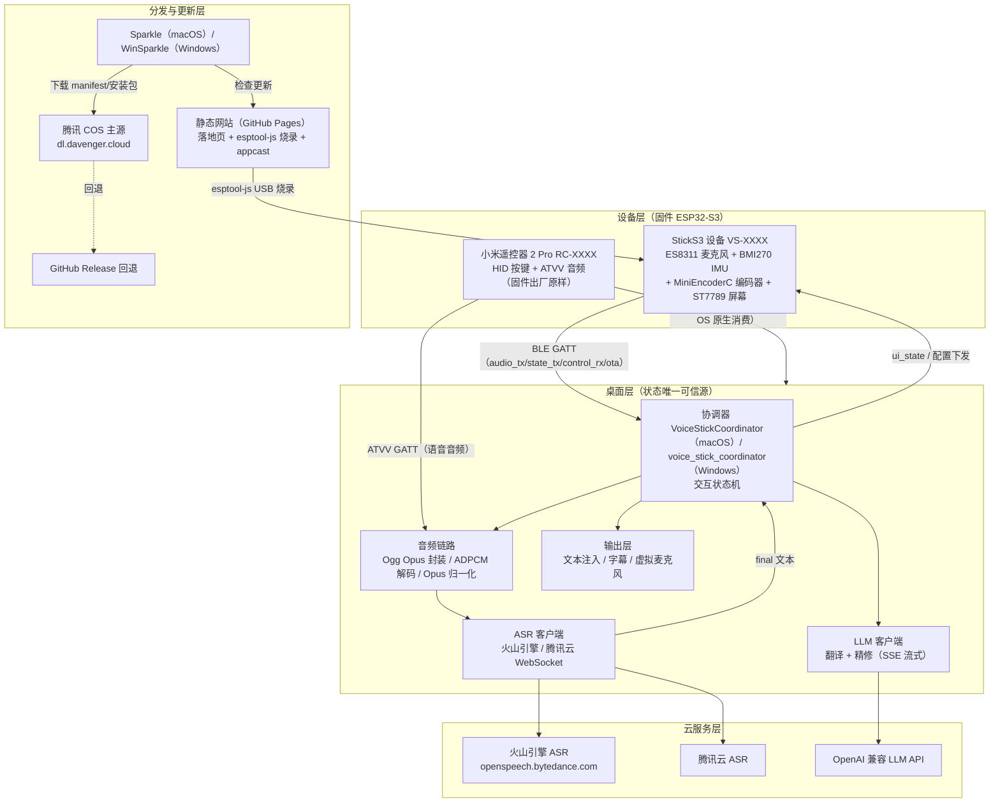

**说明与职责边界**：

- **设备层**只产生「原始事实」（按键事件、Opus 音频帧、IMU 数据、电量），不理解业务语义；屏幕仅渲染桌面端下发的 `ui_state`。
- **桌面层**是全系统唯一的交互状态机所在：设备上报的 `button_up`、`button_double_click` 等事件由协调器按当前状态解释为「开始录音/确认粘贴/取消/恢复」等行为。
- **云服务层**无状态，只提供 ASR 与 LLM 能力；密钥只存在于本机 `config.toml`，不入仓库。
- **分发层**负责固件与安装包三渠道同步（COS 主源 + GitHub 回退 + 静态网页），更新走官方渠道并校验签名/SHA-256。

### 1.3 核心架构特征（红线原则）

| # | 特征 | 含义 | 违反后果 |
|---|---|---|---|
| 1 | **交互状态机在桌面端** | 改交互流程优先改协调器（macOS `VoiceStickCoordinator` / Windows `voice_stick_coordinator.cc`）；固件只做硬件 I/O 与 `ui_state` 渲染。例外：双击时序检测在固件端（小米遥控器语音键在桌面端适配层） | 状态逻辑分散，双端行为漂移 |
| 2 | **小米遥控器固件零改动** | ATVV 会话/ADPCM 解码/Opus 归一化全部在桌面端 | 破坏「免刷机」承诺 |
| 3 | **协议变更三端同步** | 改协议字段/状态枚举/配置项/发布产物格式时，同步 `Doc/Ref/protocol.md`、固件 C、macOS Swift、Windows C++、网站与发布脚本 | 新旧固件/桌面端静默不兼容 |
| 4 | **桌面端是状态唯一可信源** | 「已连接」以对端反向证据为准（心跳回包、入站数据），不以本地 CCCD 订阅状态为准 | 假连接/静默失效不可感知 |
| 5 | **音频流下行零解码** | StickS3 路径 Opus 直接封装 Ogg Opus 送 ASR，不回解码 PCM（微信输入法模式是唯一例外） | 延迟与音质损失 |
| 6 | **双端算法逐位对齐** | PCM 后处理、ATVV 状态机、运动学等在 Swift/C++/Python 三端 bit 级对齐 | 双端行为不一致，难复现 |

---

## 2. 核心模块分层

### 2.1 分层总览

系统采用「平台外壳 → 可测试核心 → vendored C 库」的三层漏斗结构，**新增核心行为必须先放入纯逻辑核心层**（可单测），平台外壳只做 OS 适配。

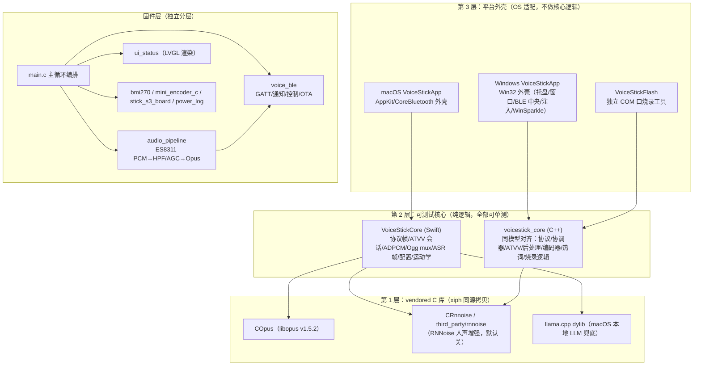

**说明与职责边界**：

- **第 3 层**持有全部 OS 依赖（CoreBluetooth / WinRT BLE、SendInput/CGEvent 注入、托盘与窗口），任何依赖平台的代码不得下沉到第 2 层。
- **第 2 层**是双端镜像的算法与状态机（ATVV 会话、PCM 后处理、热词选择、体感鼠标运动学），改动必须双侧同步并保持三端（含 Python 镜像测试）bit 级对齐。
- **第 1 层**是 vendored 第三方源码（xiph 同源），只随上游升级，不做本地功能性修改。
- **固件层**内部按「编排 → 管道 → 传输 → 渲染 → 驱动」组织，`main.c` 是唯一编排点，组件间经 FreeRTOS 队列/StreamBuffer 通信。

### 2.2 固件层组件清单（`firmware/components/`，共 7 个）

| 组件 | 职责 | 关键依赖/约束 |
|---|---|---|
| `main`（`firmware/main/main.c`） | 主循环：编排按键、BLE、录音会话、UI 状态、电源管理、OTA 事件 | 唯一编排点，不持业务状态 |
| `audio_pipeline` | ES8311 采集 16 kHz/16bit/mono PCM → HPF + 软件 AGC（target -6 dBFS、max +20 dB、噪声门、0.8FS 限幅）→ Opus 编码 | 开头 60 ms 静音+淡入、尾帧 drain 淡出消按键音；硬件 ALC 已关 |
| `voice_ble` | GATT 服务（5 特征）、通知发送、控制写入解析、BLE OTA | FreeRTOS 大缓冲必须 `...WithCaps(..., MALLOC_CAP_SPIRAM)` |
| `ui_status` | ST7789/LVGL 渲染、亮度、休眠、OTA 进度显示 | 中文字形不在 LVGL 字体集，`text` 只用于选固定英文提示 |
| `bmi270` | IMU 驱动（体感鼠标、敲击检测、拾起唤醒） | I2C |
| `mini_encoder_c` | MiniEncoderC 编码器（I2C @0x42，按钮/旋转增量/SK6812 LED），轮询式 | 探测失败优雅降级；不能作为深睡唤醒源 |
| `stick_s3_board` | 板级初始化与引脚定义（主键 GPIO11 / 侧键 GPIO12 / 背光 GPIO38 等） | 引脚见 `include/stick_s3_board.h` |
| `power_log` | 分模式功耗记账（纯观察组件，不改电源状态机），RAM 环形缓冲 + SPIFFS 环形文件 | 经 `control_rx`/`state_tx` 的 `power_log` 命令导出 |

### 2.3 macOS 桌面端（三个 SwiftPM target）

| Target | 职责 | 关键模块 |
|---|---|---|
| `VoiceStickCore` | 平台无关纯逻辑，全部可单测 | BLE 协议帧、`XiaomiAtvvSession`（自 Windows 逐行移植）、IMA-ADPCM 解码、PCM 后处理、Opus 重编码、Ogg mux、ASR 帧格式、配置解析、`AirMouseKin` 体感运动学、`LlmSseParser`、`HotwordSelector` |
| `COpus` | vendored libopus（xiph v1.5.2，与 Windows `third_party/opus` 同源） | 供 Core 调用（Windows 侧 Opus 编码在 app 层） |
| `CRnnoise` | vendored rnnoise（xiph master，BSD-2，仅推理最小集） | `AudioEnhancer.swift` 做 ASR 前人声增强，失败回退透传 |
| `VoiceStickApp` | AppKit/CoreBluetooth 平台外壳 | `VoiceStickCoordinator`（状态机）、`BleCentral`/`BleProtocol`、`OggOpusMuxer`、`TencentASRClient`/`ASRWebSocketClient`、`LLM*Client`、`InputInjector`/`KeySpec`、`XiaomiF5Suppressor`、`OverlayController`/`SubtitleController`/`StatusController`、体感鼠标链路、固件更新、设置窗口、`AppFileLog` |

测试：`swift run VoiceStickTests`（executable 测试 runner，CLT-only 无 XCTest）。

### 2.4 Windows 桌面端（五个源码目标 + winsparkle_lib）

| 目标 | 职责 | 关键模块 |
|---|---|---|
| `voicestick_core` | 可测试核心库 | 配置解析、BLE 协议（`DeviceClass`/`VS-`/`RC-` 双前缀）、Ogg mux、ASR/LLM、热词挖掘、协调器状态机、小米接入全套（`xiaomi_atvv_protocol`/`xiaomi_atvv_session`/`ima_adpcm_decoder`/`pcm_postprocessor`/`audio_opus_encoder`/`audio_enhancer`）、VoiceStickFlash 烧录逻辑（`com_port_selector` 等） |
| `VoiceStickApp` | Win32 平台外壳 | 托盘、窗口、BLE 中央、剪贴板/`SendInput` 注入、全局热键、WinSparkle、各对话框 |
| `VoiceStickFlash` | 独立 COM 口烧录小工具（BLE OTA 之外的用户级兜底） | Win32 GUI + esptool 子进程 |
| `voicestick_windows_tests` | assert 式核心单测（`tests/core_tests.cc`） | 自定义 Fake/Mock 不联网 |
| `voicestick_integration_tests` | L1 ASR 链路集成测试（`tests/integration_tests.cc`） | 真连火山 ASR，无 key 返回 77 被 CTest 记 SKIP（不伪造结果） |

构建/测试入口：根目录 `build_win.bat`；`ctest --test-dir desktop\windows\build-x64 --output-on-failure`。

### 2.5 网站端

Vue 3 + Vite + vue-i18n + esptool-js 静态站点：落地页、浏览器 USB 烧录（写 `manifest.json` 的 `merged_url` 同源副本）、Sparkle/WinSparkle 更新源与固件分发页。构建 `cd website && npm run build`，无自动化测试。

### 2.6 跨端模块映射表（改一处必查其余）

| 能力 | 固件（C） | macOS（Swift） | Windows（C++） |
|---|---|---|---|
| BLE 协议帧 | `voice_ble` | `BleProtocol` | `BleProtocol` |
| ATVV 会话状态机 | —（固件不实现） | `XiaomiAtvvSession` | `xiaomi_atvv_session` |
| ADPCM 解码 | — | Core 内 IMA-ADPCM | `ima_adpcm_decoder` |
| PCM 后处理（平滑→HPF→增益→AGC） | `audio_pipeline`（原始实现） | Core PCM 后处理 | `pcm_postprocessor`（逐字移植） |
| 双击时序检测 | 固件端（StickS3 主/侧键） | 适配层（遥控器语音键） | 适配层（遥控器语音键） |
| 编码器速度估计 | 10 ms 轮询计数 | `EncoderRotateSpeedEstimator` | `encoder_speed.h` |
| 日志入口 | 串口 | `AppFileLog`（dup2 stderr→日志文件） | `log.cc` |

---

## 3. 组件交互关系

### 3.1 BLE 链路建立与订阅时序

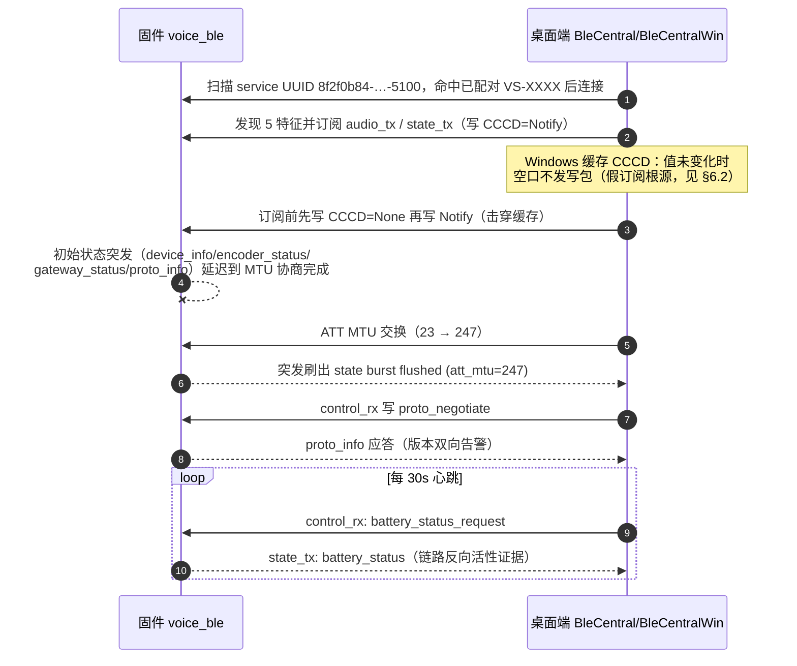

**说明与职责边界**：

- **固件**负责：GATT 事件驱动、状态突发按 MTU 预算分帧、心跳应答。**桌面端**负责：扫描过滤（仅连已配对 ID）、CCCD 击穿、版本协商、以「入站数据」判定链路健康。
- 关键节点：**初始突发延迟**（`state burst deferred until MTU exchange completes`）防止首帧在 MTU 23（JSON 预算仅 16 字节）下被截断；**1.2 s 兜底定时器**防止对端永不完成 MTU 交换时突发永挂。

### 3.2 语音输入会话时序（push-to-talk 主链路）

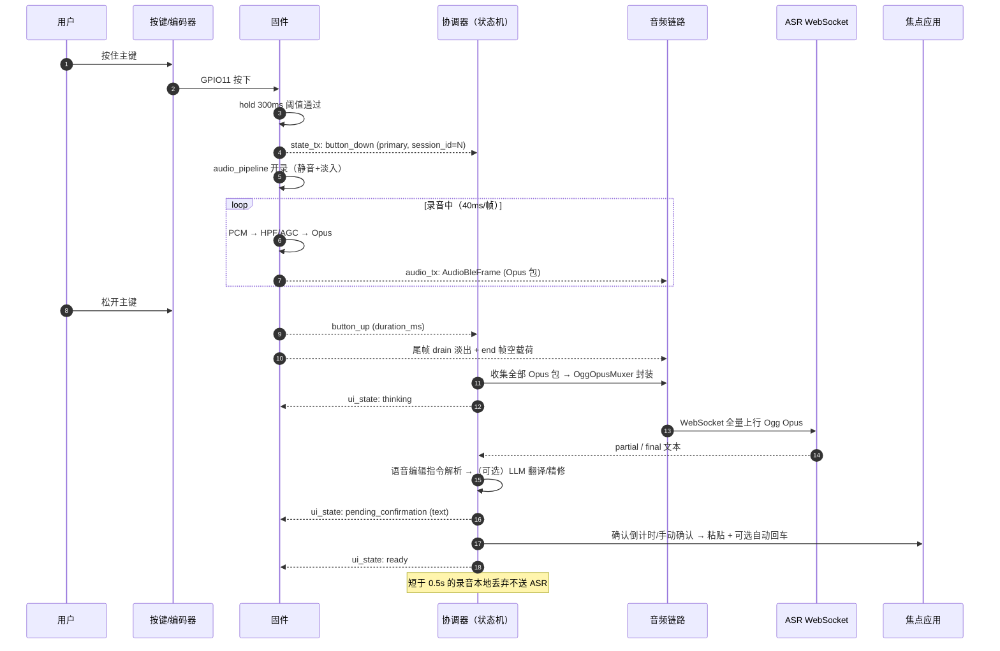

**说明与职责边界**：

- **固件**只上报按键事实与音频帧，`session_id` 由固件分配用于对齐会话；**协调器**拥有全部业务语义（何时算录音、何时送 ASR、何时粘贴）；**ASR** 只回文本。
- `click_to_talk` 模式下起/止都是 `button_click`，以 `duration_ms`（0=起，>0=止）+`session_id` 消歧，防状态失步后误判。
- 全局热键/编码器双击录音走 `remote_button_down/up`（`control_rx` 注入的虚拟主键），不经物理按键路径。

### 3.3 小米遥控器接入时序（网关模式）

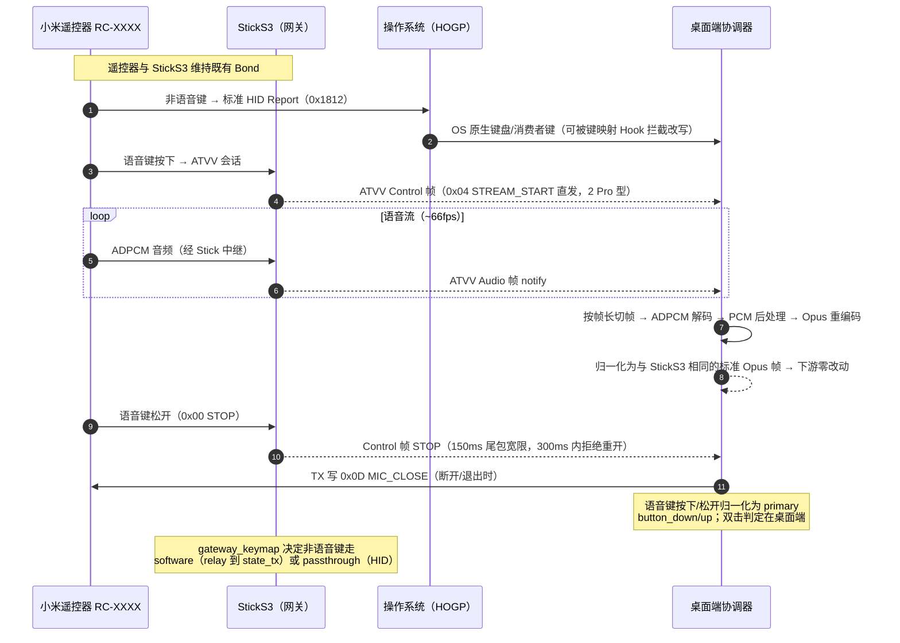

**说明与职责边界**：

- **StickS3 固件**在网关模式下是「隧道」：只转发 ATVV 帧与按 `gateway_keymap` 路由按键，不理解音频内容；**全部 ATVV 智能都在桌面端**（`XiaomiAtvvSession` / `xiaomi_atvv_session`，双端逐行移植）。
- 语音键与非语音键是**两条独立通道**（ATVV Control vs HOGP HID Report），互不感知——排障时须分别验证（见 §6.6）。
- 2 Pro 型免 `0x08`/ACK 握手（`0x04` 直开流）；RC003 旧型需 `0x0C` ACK 且无 SYNC 硬重置解码器。
- 直连模式（遥控器直接连桌面）与网关模式共用桌面端 keymap；固件 `gateway_status="gateway"` 时桌面端抑制直连 ATVV（网关模式遥控器 Bond 在 Stick 上，直连必失败）。

### 3.4 BLE OTA 固件升级时序

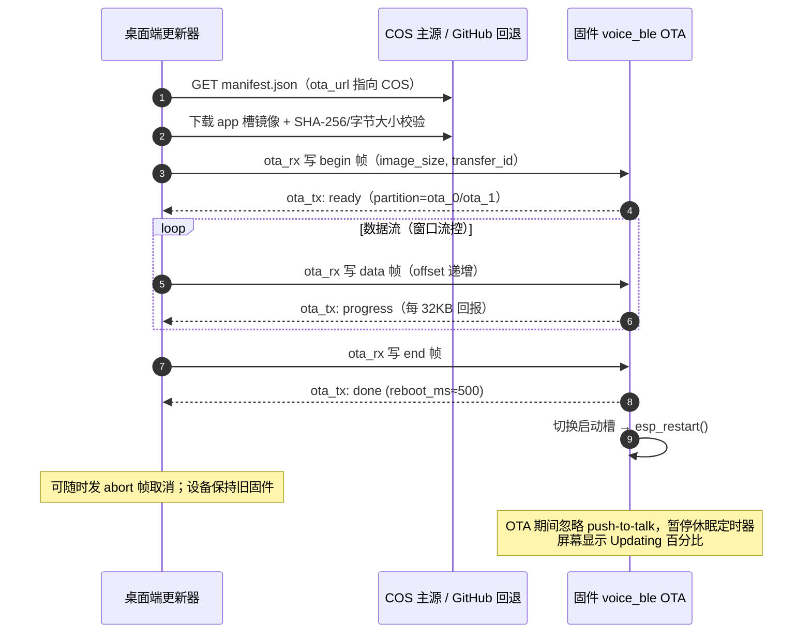

**说明与职责边界**：

- **更新器**负责 manifest 解析、下载校验（SHA-256）、窗口流控与断点语义；**固件**负责槽位管理、进度回报、`bad_offset` 等错误码。
- **app×固件流控参数是跨版本契约**（在途窗口大小 vs 进度回报间隔），改任一侧必须在最旧服役固件上真机过一遍 OTA——互等死锁见 §6.3。
- USB 串口烧录走独立链路（网站 esptool-js 写 merged 镜像 @0x0 / VoiceStickFlash 工具），与 BLE OTA 互为兜底。

### 3.5 交互状态机（双端视图）

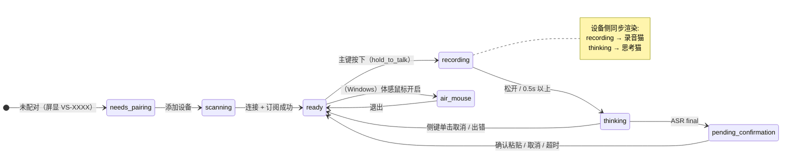

**说明与职责边界**：此为**桌面端**状态机（固件侧只有 `boot→advertising→connected→idle→recording→idle` 的本地视图）。各状态下主键/侧键语义见 `Doc/Agent/interaction-model.md` 的状态表；设备屏幕始终渲染桌面端 `ui_state` 下发（`ready/recording/thinking/pending_confirmation/error/air_mouse`）。

---

## 4. 关键数据流

### 4.1 音频主数据流（StickS3 → ASR → 注入）

```mermaid
flowchart LR
    MIC["ES8311 麦克风<br/>I2S 16kHz/16bit/mono"] --> PCM["PCM 帧流"]
    PCM --> DSP["固件 audio_pipeline<br/>HPF → 软件 AGC<br/>（-6dBFS 目标/+20dB 上限）"]
    DSP --> ENC["Opus 编码<br/>16kHz/mono/40ms"]
    ENC --> BLE1["BLE audio_tx<br/>AudioBleFrame（不回解码）"]
    BLE1 --> MUX["桌面端 OggOpusMuxer<br/>Opus→Ogg Opus 封装"]
    MUX --> ASR["ASR WebSocket<br/>（火山/腾讯/VoiceStick Cloud）"]
    ASR --> TXT["识别文本 final"]
    TXT --> REFINE["可选：语音编辑指令解析<br/>→ LLM 翻译/精修"]
    REFINE --> OUT["文本注入<br/>focused_app 粘贴 / subtitle 字幕"]

    style BLE1 fill:#e8f5e9
    style MUX fill:#e8f5e9
```

**说明与职责边界**（绿色节点 = 「下行零解码」边界，StickS3 路径 Opus 包原样穿透桌面端直到 ASR，中间不做 PCM 往返，这是低延迟的关键保证）：

| 节点 | 职责 | 层级归属 |
|---|---|---|
| `audio_pipeline` | 采集、降噪整形、编码、消按键音 | 固件 |
| `audio_tx` 帧传输 | 40 ms/包流式通知，`flags` bit0=start/bit1=end | 固件 voice_ble |
| `OggOpusMuxer` | 纯封装，不改音频内容 | 桌面端核心层 |
| ASR 客户端 | WebSocket 二进制分帧、首包请求 payload、断线错误处理 | 桌面端核心层 |
| 协调器 | 会话生命周期、编辑指令、精修调度、注入决策 | 桌面端平台外壳 |

### 4.2 微信输入法模式数据流（唯一解码例外）

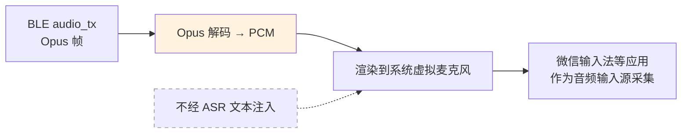

**说明与职责边界**：三种输出目标中唯一把 Opus 解码回 PCM 的路径（`wechat_input_method`）；`hold_to_talk_instant` 模式跳过 300 ms 保持阈值以最小化起播延迟。字幕模式（`subtitle`）仍走 ASR 但只显示不注入。

### 4.3 小米遥控器音频归一化数据流

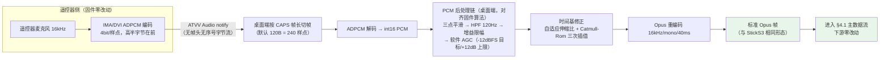

**说明与职责边界**：

- 绿色节点 = **归一化边界**：遥控器音频在进协调器前已变为与 StickS3 一致的标准 Opus 帧，ASR/Ogg/注入链路感知不到设备差异。
- 无序号字节流意味着**丢一个 notify 包解码器就会漂移**，直到下一个 `0x0A` AUDIO_SYNC 或会话硬重置（RC003 在 `0x04` 时硬重置）。
- 时间基修正与三次插值是「音频变快/发闷」三缺陷修复的落点（详见 §6.4）。
- 可选 RNNoise 人声增强插在解码与重编码之间（`audio_noise_suppression`，默认关，失败回退透传）。

### 4.4 控制/状态回传流（桌面端 → 设备）

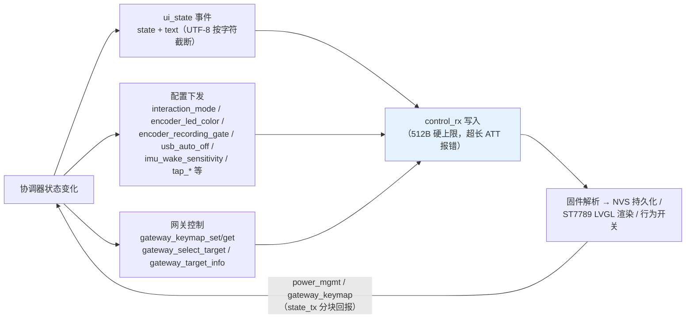

**说明与职责边界**（蓝色节点 = 帧预算敏感点）：

- `ui_state` 是**权威显示状态**：固件可先渲染本地物理反馈（如按下即亮录音猫），但最终以 `ui_state` 为准。
- **帧预算硬约束**：`state_tx` JSON ≤ ATT MTU−3（MTU 247 时 240 B；新增 `state_tx` 帧必须按 MTU 23 的 16 B 预算预演一遍）；`ui_state.text` 限 255 B，整帧超 512 B 被固件 ATT 拒绝，截断则整帧丢弃（屏幕卡旧提示，见 §6.7）。
- `gateway_keymap` 全表 ~470 B 必然分块（`seq`/`more`，从 seq:0 累积、`more:false` 才生效）。

### 4.5 固件分发与更新数据流

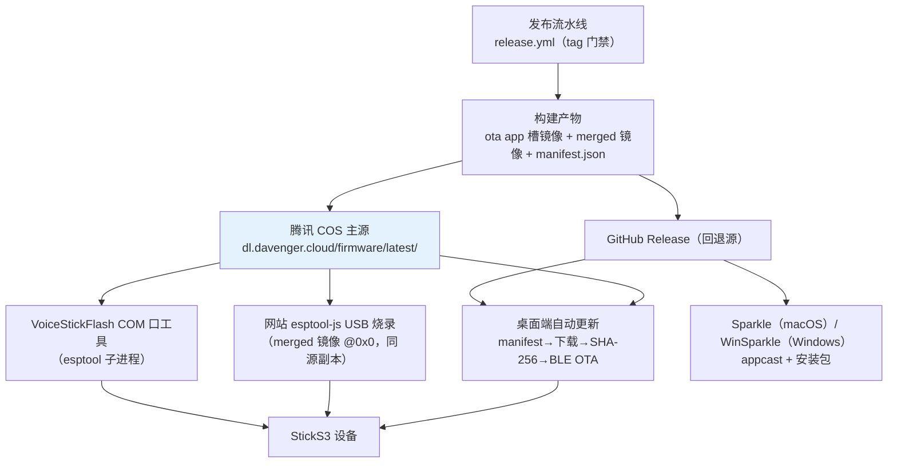

**说明与职责边界**：COS 是国内主源（蓝色），GitHub 是回退；`min_version` 低于阈值的设备强制升级提示。桌面安装包与固件是**两条独立更新轨道**（Sparkle/WinSparkle vs BLE OTA），发布时按轮次分别同步。

---

## 5. 专用名词术语表

### 5.1 设备与硬件

| 术语 | 本系统中的定义与作用 |
|---|---|
| **StickS3** | M5Stack 出品的 ESP32-S3 开发板，本项目的自研输入设备载体，运行本仓库固件 |
| **VS-XXXX / RC-XXXX** | 设备 ID 前缀区分设备类：`VS-`=自研 StickS3（取 eFuse MAC 后两字节），`RC-`=小米遥控器 2 Pro（Windows 取蓝牙地址低 16 位；macOS 取外设 UUID SHA-256 前 4 位） |
| **ES8311** | StickS3 板载音频 codec，I2S 接口，本系统采集 16 kHz/16 bit/单声道 PCM |
| **BMI270** | 板载 IMU（加速度计+陀螺仪），驱动体感鼠标、双击敲击检测与拾起唤醒 |
| **MiniEncoderC** | 顶部 Hat 排针外接的旋转编码器（I2C @0x42，SDA=G8/SCL=G0 第二路总线）：按钮等价主键、旋转映射方向键、录音亮 LED；探测失败优雅降级，**不能作为深睡唤醒源** |
| **ST7789 / LVGL** | 135×240 竖屏 LCD 与其渲染库；固件只渲染桌面端下发的 `ui_state`（字体集无中文，`text` 仅用于选固定英文提示） |
| **eFuse MAC** | ESP32 熔丝烧录的出厂 MAC，`VS-XXXX` ID 的来源 |
| **SPIFFS / NVS** | 固件片上文件系统/键值存储：SPIFFS 存 `power_log.bin` 与测试 PCM；NVS 持久化编码器设置、网关路由表等 |
| **深度睡眠（Deep Sleep）** | 电池供电 5 分钟空闲后的最低功耗态，仅主键（GPIO11）可唤醒；MiniEncoderC 是 I2C 外设不可唤醒 |

### 5.2 BLE 与通信协议

| 术语 | 本系统中的定义与作用 |
|---|---|
| **BLE GATT** | 蓝牙低功耗通用属性规范。本系统服务 UUID `8f2f0b84-6e6f-4b23-88f7-3a3ceafc5100`，含 `audio_tx`/`state_tx`/`control_rx`/`ota_rx`/`ota_tx` 五特征 |
| **CCCD** | Client Characteristic Configuration Descriptor，订阅开关（写 `Notify` 开、`None` 关）。**Windows 会缓存 CCCD 值，值未变不发空口包**——订阅假成功的根源，修复=先写 None 再写 Notify |
| **ATT MTU** | 单个 ATT 包最大传输单元。状态帧预算 = MTU−3（MTU 247 → JSON 240 B；MTU 23 → 仅 16 B）。初始状态突发必须等 MTU 协商完成后再发 |
| **Notify / Write-Without-Response** | BLE 两种免应答传输：notify 设备→主机推送；write-without-response 主机→设备快速写（音频/OTA 数据用） |
| **HOGP / HID over GATT** | 基于 GATT 的标准人机接口设备规范。小米遥控器**非语音键**走此通道由 OS 原生消费；要求 OS 级配对（Bond） |
| **Bond / OS 级配对** | 系统层蓝牙配对（无配对码）。遥控器只接受新 Bond 于配对模式（Home+Menu 3–5 s）；**测试/自愈严禁解除配对**（会弄死 HOGP 按键直通） |
| **广播（Advertising）** | 设备可连接期的 BLE 广播。**注意：watcher 收到的报告可能延迟/复用，不等于设备此刻真在广播**——拆会话前须确认最近 1 s 无入站数据且无 OTA 在跑 |
| **ATVV** | Google 的「Assist → Text-to-…Voice」蓝牙语音配置（service `AB5E0001-…`）。小米遥控器语音通道：TX 命令/Audio/Control 三特征，会话由遥控器驱动（`0x04` STREAM_START 开流 / `0x00` STOP / `0x0D` MIC_CLOSE） |
| **心跳（battery_status_request）** | 桌面端每 30 s 经 `control_rx` 轮询电量，固件必答——应答即链路反向活性证据，用于「假连接」检测 |
| **session_id** | 固件为每次录音分配的 uint32，用于按键事件与音频帧的会话对齐 |
| **proto / min_proto** | 协议版本协商：`proto_info`（固件→桌面）与 `proto_negotiate`（桌面→固件）双向宣告，越界双方都大声告警，防静默不兼容 |

### 5.3 音频与信号处理

| 术语 | 本系统中的定义与作用 |
|---|---|
| **Opus / Ogg Opus** | 低延迟语音编解码及其容器。设备端 40 ms/包编码；桌面端 StickS3 路径只封装不解码，直接送 ASR |
| **IMA/DVI ADPCM** | 小米遥控器的音频编码（4 bit/样点、16 kHz、高半字节在前、无帧头无序号），桌面端解码后归一化为 Opus |
| **HPF（高通滤波）** | 120 Hz Butterworth 高通，抑制喷麦/低频噪声；固件链与桌面后处理链算法一致 |
| **AGC（自动增益控制）** | 软件增益：固件链目标 −6 dBFS/上限 +20 dB；桌面后处理链（小米路径）目标 −12 dBFS/上限 +12 dB，含噪声门与 0.8FS 瞬时限幅 |
| **dBFS** | 数字音频满刻度相对电平，AGC 目标与限幅阈值单位 |
| **RNNoise** | xiph 开源人声降噪模型（vendored 同源拷贝，macOS `CRnnoise`/Windows `third_party/rnnoise`）；`audio_noise_suppression` 开关默认关，失败回退透传 |
| **Catmull-Rom 插值** | 时间基修正使用的三次插值。**线性插值在 4 kHz 重采样下 −3 dB（听感发闷）**，必须用三次 |
| **时间基修正** | 遥控器自身采集均匀压缩 ~9% 的对抗：自适应伸缩比 + 三次插值，在 Stick 侧恢复正确时长 |
| **零余量（I2S DMA 环）** | DMA 环形缓冲时长小于一次读请求时长 ⇒ 采集必然丢样。已修：环 80 ms + audio_task 优先级 7 |
| **消按键音** | 录音开头 60 ms 静音+淡入、结束尾帧 drain 淡出，由固件 audio_pipeline 实现 |
| **虚拟麦克风（wechat_input_method）** | 把 Opus 解码回 PCM 渲染到系统虚拟麦克风供微信输入法采集的输出目标，不经 ASR 文本注入，是全链路唯一解码例外 |

### 5.4 桌面端架构与云服务

| 术语 | 本系统中的定义与作用 |
|---|---|
| **协调器（Coordinator）** | 桌面端交互状态机载体（macOS `VoiceStickCoordinator` / Windows `voice_stick_coordinator.cc`），全系统业务语义唯一裁决者 |
| **状态唯一可信源** | 架构原则：连接健康、交互状态、粘贴决策均以桌面端为准，且必须取对端反向证据（心跳回包/入站数据）而非本地订阅状态 |
| **ASR** | 自动语音识别。三通道同构 WebSocket 二进制分帧：火山引擎（默认）、腾讯云（含热词表客户端）、VoiceStick Cloud 中继 |
| **Ogg Opus mux / 帧格式** | 桌面端把 Opus 包封装为 Ogg 流后按 ASR 帧格式上行；三端（Swift/C++/Python 镜像测试）逐位对齐 |
| **LLM 精修 / 翻译** | OpenAI 兼容 API 对 final 文本做纠错精修（v2.4.7 起 SSE 流式 `refineStream`，失败回退非流式）与翻译；macOS 另有内嵌 llama.cpp 本地兜底（候选约束式，失败回退旧行为） |
| **热词（Hotword）** | 提升专有名词识别率：`HotwordSelector` 候选评分裁剪 + 腾讯热词表下发；候选挖掘器 `hotword_candidate_miner` |
| **语音编辑指令（voice_edit）** | final 整句命中「删除最后两个字/撤销/把刚才的X改成Y」等指令时本地执行编辑（注入退格或精确选区替换），命令文本不上屏；targeted 动作任何模式下都必须 verified（读回校验） |
| **注入（InputInjector / SendInput / CGEvent）** | 平台文本/按键注入：剪贴板+粘贴键、回车、方向键、鼠标移动/点击；macOS 走 AX/UI 事件，Windows 走 SendInput/UIA |
| **verify_mode / verified** | 注入安全分级：strict/auto/off 决定「读不到字段」时是否允许盲操作；targeted 编辑恒 verified |
| **网关模式（gateway）** | StickS3 作为遥控器↔桌面端隧道的运行模式（2026-09-27 起固件**恒为网关模式**开机）；`gateway_status`/`gateway_key`/`gateway_keymap` 系列事件支撑 |
| **直连模式** | 遥控器直接连桌面端（绕过 Stick）。网关模式下被桌面端抑制（Bond 在 Stick 上，直连必失败） |
| **体感鼠标（air_mouse）** | BMI270 角速度经 `motion` 二进制帧（50 Hz，type 0x11）上报，桌面端做增益曲线/方向锁/亚像素累积后注入鼠标；仅 Windows |
| **EWMA 速度估计** | 编码器旋转快慢分档的指数滑动平均（`EncoderRotateSpeedEstimator`/`encoder_speed.h`），消除 10 ms 窗口量化阶跃 |
| **WinSparkle / Sparkle** | Windows/macOS 桌面安装包自动更新框架，appcast 源指向 COS 主源 + GitHub 回退 |
| **esptool-js / VoiceStickFlash** | 浏览器 USB 烧录（写 merged 镜像 @0x0）与 Windows COM 口烧录工具，均为 BLE OTA 之外的兜底链路 |
| **merged 镜像 / app 槽镜像** | 8 MB flash 双 3 MB OTA 槽（ota_0 @0x10000 / ota_1 @0x310000）：BLE OTA 用单槽 app 镜像，USB 烧录用从 0x0 起的 merged 镜像 |
| **归一化边界** | 小米遥控器音频进入协调器前被转换为与 StickS3 相同的标准 Opus 帧的分界点——下游全链路设备无感 |
| **DebugAudio** | 桌面端调试音频缓存：把实际上行的音频字节回放给 ASR 以还原识别文本，用于「准确率」问题分层定位 |

---

## 6. 常见故障排查指引

### 6.0 分层定位法（总原则）

先定层级、再定节点、最后改代码——**用日志判据说话，不猜**：

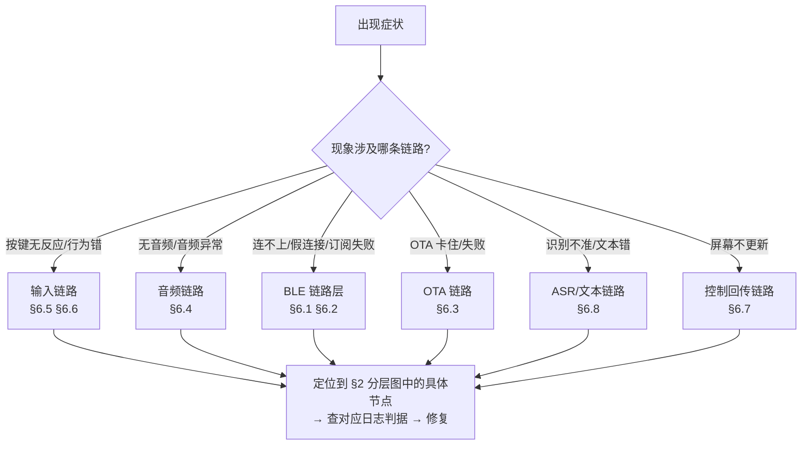

**通用判据入口**：

| 端 | 日志/工具位置 |
|---|---|
| Windows 桌面端 | `%LOCALAPPDATA%\VoiceStick\VoiceStickApp.log`（`log.cc`） |
| macOS 桌面端 | `~/Library/Application Support/VoiceStick/VoiceStickApp.log`（`AppFileLog`，8 MB 轮转；统一日志 NSLog 已脱敏为 `<private>` 不可读） |
| 固件 | USB JTAG 串口日志（`usb-jtag-flash-log` skill；判据关键字 `source=`、`frame=`、`stretch=`、`att_mtu=`、`state burst`） |
| 链路探测 | `scripts/probe_asr_websocket_ping.py`（ASR 连通）、`scripts/e2e_test/`（真机验证；自动化一律走 app，如 `VoiceStick.exe --gateway-target self|clear`） |

**三条铁律**（违反即制造新故障）：

1. **BLE 自愈/恢复路径绝不可 unpair**——删除 `Enum\BTHLE` 节点会弄死 HOGP 按键直通，且设备被 app 连上时 `PairAsync` 必失败（status=19）。
2. **测试不能解除系统配对**；E2E 自动化一律走 app 驱动（app 退出后 Windows 系统级 HOGP 会连走设备，第三方 central 扫不到）。
3. **拆「疑似僵尸」会话前先确认它真死了**：最近 1 s 有入站数据、或有固件升级在跑 ⇒ 绝不拆（广播报告可能延迟/复用，不代表链路真死）。

### 6.2 「订阅成功但对端收不到帧」（假订阅家族）

**对应架构节点**：§3.1 BLE 链路建立时序 → `state_tx` 特征 / CCCD / ATT MTU。

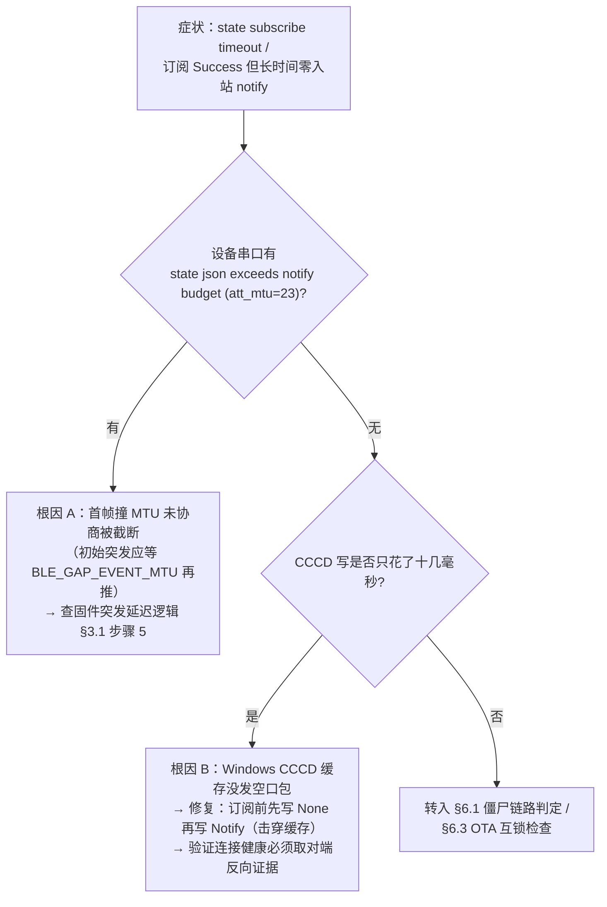

**排查步骤**：① 抓桌面端日志确认订阅返回时间（十几 ms=可疑缓存写）；② 抓固件串口查 MTU 截断告警；③ 用 `battery_status_request` 心跳回包作反向活性证据——回包正常则链路活，问题在桌面端消费；④ 修复后确认串口出现 `state burst flushed after MTU exchange (att_mtu=…)`。

### 6.3 BLE OTA 卡死（`stalled` 且 `sent` 恒等于窗口值）

**对应架构节点**：§3.4 OTA 时序 → 更新器窗口流控 × 固件进度回报间隔。

**判据**：app 侧 `stalled` 且 `sent` 恒等于在途窗口大小（不是随机值——随机值才是链路抖动）= app 在途窗口与固件进度回传间隔**互等死锁**（例：v2.4.0 app 24 KB 窗口 × v2.3.8 固件 32 KB 回报间隔）。

**排查路径**：① 对照两端的窗口/间隔参数版本契约；② 升级任一侧对齐参数；③ **回归要求：改任一侧必须在最旧服役固件上真机过一遍 OTA**。另注意：网关模式 OTA 曾被「陈旧广播报告误判会话死亡」反复拆链（+30 s/16% 断链），若 OTA 中断伴随会话重建日志，转 §6.1 铁律 3。

### 6.4 遥控器音频「变快 / 发闷」

**对应架构节点**：§4.3 归一化数据流 → 固件 I2S DMA 环 / 桌面端时间基修正 / 插值算法。

| 判据（固件串口） | 指向的缺陷 | 修复落点 |
|---|---|---|
| `source=1`（遥控器中继）下 `frame=` ≠ 40000us，或 Stick 麦链路丢样 13%~50% | ① I2S DMA 环（30 ms）小于一次读请求（40 ms）⇒ 零余量丢样 | 固件：环扩到 80 ms + audio_task 优先级 7 |
| 音频时长均匀缩短 ~9%（基频 108.1 vs 正常 98.8 Hz、帧数比 0.909） | ② 遥控器采集均匀压缩 | 桌面端：时间基自适应伸缩比 |
| 听感发闷（高频 −3 dB） | ③ 修正用了线性插值 | 换 Catmull-Rom 三次插值 |

**排查步骤**：先看串口 `source=`（0=Stick 麦/1=遥控器中继；**app 日志与文件名都区分不了**）→ `frame=`/`stretch=` 判据定位到上表三行之一 → 只改对应层。

### 6.5 「语音键正常、其他按键没反应」（小米遥控器）

**对应架构节点**：§3.3 双通道结构 → HOGP HID 通道 vs ATVV 语音通道。

**排查路径**：① 两条通道独立会互相掩盖——先确认语音键是否经 ATVV（Control 帧）而其他键走 HID Report；② 检查**OS 级配对**是否存在（Windows 设置里手动配对；BLE HID 直通要求 Bond）；③ 检查桌面端键映射（`[xiaomi.keys]`/`[device.<id>.xiaomi.keys]`）是否把键 `disabled` 或路由到 software；④ 网关模式再查固件 `gateway_keymap` 路由（software → `gateway_key` 事件 / passthrough → HID）。**任何情况下不要 unpair 重配**（铁律 1）。

### 6.6 「设备重启后显示已连接却语音静默失效」（僵尸链路）

**对应架构节点**：§3.1 心跳与链路健康 → 桌面端「假连接」检测 / 自愈路径。

**判据链**：`state subscribe status=Success` 后长时间零入站 notify + 设备串口 `send_state_json gated: state_sub=0` ⇒ 订阅假成功（转 §6.2 根因 B）。**健康判定必须取对端反向证据**（30 s 心跳回包；macOS D3b：>90 s 无入站且心跳不答 ⇒ 主动断开走 重连→重扫→重订阅，**永不 unpair**）。自愈过程若看到「已配对设备广播」日志，注意广播报告可能是延迟/复用的（铁律 3），先查最近 1 s 入站与 OTA 状态再决定是否拆会话。

### 6.7 设备屏幕卡在旧提示（ui_state 丢失）

**对应架构节点**：§4.4 控制回传流 → `ui_state` 帧预算。

**判据与排查**：① 桌面日志查 `ui_state` 写入是否失败/被截断——整帧 JSON 超 512 B 被固件 ATT 拒绝；被 512 B 缓冲截断则解析失败**连 `state` 一起丢弃**（屏幕停上一态）；② 发送端必须按字符/UTF-8 边界截断 `text` 直到整帧塞进 MTU 247 预算（244 B）；③ 新增 `state_tx` 帧先按 **MTU 23 的 16 B 预算**算一遍——放不下就拆独立小帧（先例：`device_info` 超限被瘦身，新能力走 `encoder_status`/`gateway_status` 独立帧）；④ `gateway_keymap` 类大回报确认分块累积逻辑（seq:0 起、`more:false` 才生效）。

### 6.8 语音「识别不准 / 没效果」

**对应架构节点**：§4.1 主数据流逐节点 + §4.3 归一化边界。

**分层排查（先分层再改代码）**：

1. **还原识别文本层**：用 DebugAudio 把实际上行字节回放给腾讯实时 ASR，逐轮还原识别文本，与日志 `text_len` 对账校准——先确认「设备说了什么」与「ASR 听到了什么」。
2. **音频传输层**：`Audio stream summary` 帧比例恒 0.5~0.8 ⇒ 设备端尾帧丢弃，是传输层问题，**勿改解析器/匹配逻辑**（转 §6.4 查采集丢样）。
3. **本地模型兜底层**：一律候选约束式（模型只在候选枚举内选 + 代码复验 + 失败回退旧行为）；换任务形态必须重跑 `scripts/local_align_bench` 选型，模型结论不可跨任务搬用。
4. **注入验证层**：targeted 编辑在 Chromium 系目标（Electron/浏览器）经 renderer 异步生效，写后立即读回必拿旧值——必须小步轮询确认；注入/AX 验收必须覆盖一个浏览器文本目标（原生 TextEdit 通过 ≠ Chromium 可用）；判据：`voice_targeted action=…` 后零日志 = 执行环节静默失败。

### 6.9 其他高频速查表

| 症状 | 最可能层级 | 首查节点 | 判据/动作 |
|---|---|---|---|
| Windows 构建报 `C1083: winrt/base.h` | 构建链 | `build_win.bat` 的 cppwinrt 投影 | 确认 `desktop/windows/generated_winrt/` 已生成并 prepend 到 INCLUDE |
| 单测偶发时序断言失败且失败点漂移 | 测试环境 | 运行中的 VoiceStick.exe | 跑测试前先结束运行中实例，非代码回归 |
| 全新克隆 Windows 构建缺文件 | 版本管理 | `git ls-files desktop/windows` | `.gitignore` 整体忽略该目录，须 `git add -f` 并逐个验证跟踪 |
| 烧录后串口 0 字节 / 进不了 Boot | 固件调试链 | USB JTAG 控制台 | 按 `usb-jtag-flash-log` skill 的 DTR 复位/按键时序处理 |
| 双击主键没注入 Enter | 输入链路 | §3.5 状态机 + 固件双击窗口 | 确认事件是 `button_double_click`（500 ms 窗口、每次 <300 ms）；遥控器语音键双击判定在桌面端 |
| macOS CLI 直启 app 蓝牙静默失效 | 平台权限 | TCC 归因 | 判据=进程日志零 CoreBluetooth 活动；一律 `open` 启动 |

---

## 附录：相关文档索引

| 主题 | 文档 |
|---|---|
| 协议与帧格式（含 ATVV 档案全文） | `Doc/Ref/protocol.md` |
| 桌面端配置字段 | `Doc/Ref/desktop-config.md` |
| 构建命令与测试策略 | `Doc/Agent/build-and-test.md` |
| 固件架构细节 | `Doc/Agent/firmware-architecture.md` |
| 桌面端模块细节 | `Doc/Agent/desktop-architecture.md` |
| 交互模型（状态表、按键语义） | `Doc/Agent/interaction-model.md` |
| 经验教训（排障先查） | `Doc/Expe/claude-memory-distilled.md` 及 `Doc/Expe/` 各专题 |
| 发布流程 | `Doc/Ref/release.md` |
